*This project has been created as part of the 42 curriculum by <!-- FILL: 42 logins --> <login1>, <login2>, <login3>.*

# Dev Pulse

Dev Pulse is a collaborative virtual workspace inside a **2D top-down office**: walk around with your teammates, talk naturally through proximity voice, schedule and attend isolated meeting room calls, manage Jira-style Kanban tasks from your desk, and take breaks with interactive multiplayer games in the chill room.

For comprehensive architectural specifications, development roadmap, and feature documentation, refer to **[docs/PLAN.md](docs/PLAN.md)** (team roadmap and ownership), **[docs/HANDOFF.md](docs/HANDOFF.md)** (current development state and next steps), **[docs/OFFICE.md](docs/OFFICE.md)** (virtual office mechanics, editor, and games), **[docs/AUTH.md](docs/AUTH.md)** (authentication contracts and tokens), and **[docs/code/README.md](docs/code/README.md)** ("how the code works").

## Description

- **Project Name:** Dev Pulse
- **Goal:** Provide distributed software engineering teams with an immersive, high-performance 2D virtual office that mitigates remote isolation through spontaneous spatial voice interaction, seamless desk-to-board task workflows, and zero-configuration web access.
- **Key Features:**
  - **2D Virtual Office:** Real-time multiplayer movement, customizable avatar recipes, minimap, mobile touch joystick, and sitting at interactive desks.
  - **Proximity Voice & Spatial Audio:** Peer-to-peer WebRTC mesh voice with Web Audio API HRTF 3D spatial panning and distance attenuation.
  - **Meeting Rooms & Timetable Bookings:** Acoustically isolated meeting rooms with a 08:00–20:00 booking calendar and race-free PostgreSQL advisory locking.
  - **Jira-Style Kanban Board:** Live shared task management with HTML5 drag-and-drop, float ranking, and desk interaction.
  - **Live Office Editor & Procedural Expansion:** Real-time drag-and-drop furniture arranger with optimistic concurrency locking and procedural wing expansions.
  - **Chill Room & Break Games:** Casual activities including 30 Hz server-authoritative physics Baby foot (foosball), Uno card engine, collaborative Lego art wall, and weekly leaderboards.
  - **Security & Session Management:** Single-active-device session enforcement, scrypt password hashing, rotating JWT refresh tokens in httpOnly cookies, OAuth 2.0 (Google, GitHub, 42), and TOTP two-factor authentication.

## Architecture

```
Browser ──HTTPS──► proxy (nginx) ──► web  (Next.js)  pages + Phaser game
                                 └─► api  (NestJS)   REST /api/* + Socket.IO /socket.io/*
                                          └─► db (PostgreSQL)
```

| Service | Tech | Role |
| :--- | :--- | :--- |
| `web` | Next.js 16, React 19, Tailwind 4 | UI and the 2D office |
| `api` | NestJS 11, Prisma 6, Socket.IO | One backend app, one module per feature |
| `db` | PostgreSQL 16 | Data persistence |
| `proxy` | nginx | HTTPS for everything, a single origin for the app |

## Instructions

**Prerequisites:** Docker with Docker Compose v2, and `make`.

```bash
git clone <repo-url> dev_pulse && cd dev_pulse
make            # creates .env from .env.example, builds and starts everything
```

Open **https://localhost:8443**. The certificate is self-signed, so accept the browser warning once. `/status` checks the API, database and WebSocket connections.

### Commands

| Command | What it does |
| :--- | :--- |
| `make` | Production build, runs in the background (what evaluators run) |
| `make dev` | Hot reload: edit code in `apps/` and see changes without rebuilding |
| `make db` | After editing `apps/api/prisma/schema.prisma`: push it to the DB |
| `make studio` | Prisma Studio at http://localhost:5555 (while `make dev` is running) |
| `make logs` | Follow logs (`make logs s=api` for one service) |
| `make down` | Stop containers (data is kept in persistent volumes) |
| `make clean` | Stop and **delete** the database volumes and certificate |

Added a dependency? `cd apps/web && pnpm add <pkg>` (commits the lockfile), then rerun `make dev`; it rebuilds the image.

### Running tests

- **Backend Unit Tests:** `cd apps/api && pnpm test` (runs Vitest unit tests for auth, office rules, meetings, games, and tasks).
- **Type Checking:** `pnpm typecheck` in `apps/api` and `apps/web`.
- **End-to-End Tests:** Playwright test suite in `e2e/` verifying multi-user onboarding, movement, office editor, bookings, tasks, and games. See **[docs/code/testing.md](docs/code/testing.md)** for execution instructions and architecture.

### Dev identity switcher

When `DEV_LOGIN=true` is configured in `.env`, the `/login` screen displays a one-click test account switcher allowing rapid local testing across seeded identities (owner, admin, member) without typing passwords or completing 2FA. This feature is strictly for local testing; it is ignored when `NODE_ENV=production` and must never be enabled on public deployments.

### Optional settings

`make` creates `.env` with random secrets; the app works without changing anything. Emails (confirmation, password reset, invitations) are printed in `make logs s=api` until you configure `SMTP_*`. Google / GitHub / 42 sign-in buttons appear when their respective credentials are set. See [docs/AUTH.md §5](docs/AUTH.md#5-configuration-env).

### Access from other machines (LAN)

Set `SERVER_NAME` in `.env` to your machine's IP (e.g. `10.12.1.5`), then run `make` again. The certificate is regenerated for that IP. Teammates open `https://10.12.1.5:8443`. HTTPS is required for microphone access (voice chat).

### Project layout

```
.github/
  workflows/ci.yml   CI pipeline (build, typecheck, vitest unit tests, playwright e2e)
apps/
  api/               NestJS 11 backend modular monolith
    prisma/          schema.prisma (PostgreSQL database schema)
    src/
      auth/          authentication, JWT tokens, sessions, 2FA, OAuth
      chat/          office and room chat service & gateway
      common/        guards, interceptors, auth decorators
      config/        environment configuration
      dev/           dev-only test endpoints & teleport gateway
      games/         games engine, foosball, uno, lego wall, leaderboards
      health/        health check endpoints
      invitations/   workspace email invitations
      mail/          SMTP mailer service
      meetings/      meeting room reservations & timetable
      office/        virtual office state, layout validation & wings
      settings/      user voice & keybind settings
      tasks/         Kanban tasks service & rank rebalancing
      voice/         WebRTC signaling gateway
      workspace/     workspace CRUD, members, desks & wings
  web/               Next.js 16 (React 19) frontend & Phaser 3 game
    app/             App Router pages ((auth), office, onboarding, team, settings, privacy, terms)
    features/        domain feature components (auth, office, tasks, voice, meetings, games, chat, team)
    game/            Phaser 3 office scene, avatar art, systems, layout & editor
    lib/             API client, WebSocket client, escape stack, utilities
docs/                project documentation (PLAN.md, HANDOFF.md, OFFICE.md, AUTH.md)
docs/code/           in-depth code architecture guides
e2e/                 Playwright browser test suite & fixtures
nginx/               HTTPS reverse proxy configuration & self-signed TLS cert generator
tools/
  art-lab/           standalone character avatar & desk art preview lab
Makefile             single-command docker orchestration (`make`, `make dev`, `make clean`)
docker-compose.yml   multi-container orchestration (proxy, web, api, db)
```

## Team Information

| Member | Role | Responsibilities |
| :--- | :--- | :--- |
| **Roy** | Tech Lead & Developer | Game engine (Phaser 3), 2D office scene & movement, onboarding wizard, office layout templates & live editor, desk management & plates, initial infrastructure & auth foundations |
| **Mira** | Project Manager & Developer | Authentication architecture, email invitations & member management, role-based guards (`OWNER`, `ADMIN`, `MEMBER`), 2FA (TOTP), OAuth 2.0 (Google, GitHub, 42) |
| **Zakaria** | Product Owner & Developer | Kanban task manager (backend & live UI), WebRTC proximity voice & spatial audio, meeting rooms & bookings, chill room mini-games (foosball, Uno, Lego) & leaderboards, E2E test suite & architecture documentation |

<!-- FILL: confirm roles (Roy: Tech Lead, Mira: Project Manager, Zakaria: Product Owner) -->
<!-- FILL: git history on other branches includes commits by Ahmad Mansour (voice call prototype, TLS proxy, earlier iteration): decide whether to credit -->

## Project Management

- **Planning & Task Breakdown:** Development was organized into numbered milestone tasks (`M1`–`M7`, `R1`–`R6`, `Z1`–`Z5`, `H1`–`H2`, `F1`–`F2`) as defined in [docs/PLAN.md §4](docs/PLAN.md#4-task-order-per-person). Work was scheduled on a GitHub Projects Kanban board with cards mapped to task IDs across *Todo*, *Doing*, *Review*, and *Done* columns.
  - <!-- FILL: GitHub Projects board link: <url> -->
  - <!-- FILL: communication channels (e.g. Discord server, Slack workspace, in-person campus sync) -->
  - <!-- FILL: confirm whether branch naming and PR review practice was strictly followed during development -->
- **Branching & Peer Review Workflow:** The `main` branch was designated as protected. Contributors worked on isolated feature branches formatted as `<name>/<task-id>-short-name` (e.g. `roy/R1-office`, `zakaria/Z1-tasks`, `mira/M2-login`). Pull requests required at least one review from another teammate prior to merging. Twice-weekly 15-minute check-ins and end-of-week milestone demos ensured integration across boundaries.
- **Continuous Integration (CI):** Automated through GitHub Actions (`.github/workflows/ci.yml`) on pull requests and pushes to `main`.
  - Matrix job across `apps/api` and `apps/web`: checks lockfile integrity (`pnpm install --frozen-lockfile`), compiles TypeScript (`pnpm typecheck`), executes Vitest unit tests (`pnpm test`), and builds production artifacts.
  - End-to-end testing job (`e2e`): Provisions a live PostgreSQL 16 service, runs Prisma migrations (`prisma db push`), starts the backend API and Next.js frontend behind a local reverse proxy (`serve.mjs`), and executes the complete Playwright browser suite.
- **Definition of Done:** Features must function in Chrome over HTTPS with zero console errors, enforce input validation on both frontend and backend, pass unit and E2E gates, and receive peer review approval before merging.
- **Handoff Tracking:** Development status, completed components, and remaining milestones were maintained throughout in **[docs/HANDOFF.md](docs/HANDOFF.md)**.

## Technical Stack

| Layer / Role | Technology | Version | Description & Role |
| :--- | :--- | :--- | :--- |
| **Frontend Framework** | Next.js / React | `16.3.8` / `19.3.0` | App Router, Server Components & interactive client islands |
| **Frontend Styling** | Tailwind CSS | `4.3.3` | Utility-first responsive styling for HUD, modals, and drawers |
| **Game Engine** | Phaser 3 | `3.90.0` | 2D canvas/WebGL game engine for office movement & collisions |
| **Backend Framework** | NestJS (Express platform) | `^11.2.7` (`@nestjs/platform-express`) | Modular monolith backend architecture with dependency injection |
| **Runtime & Language** | Node.js / TypeScript | `22-alpine` / `5.9.3` | Modern JavaScript runtime & strict static typing across packages |
| **Database & ORM** | PostgreSQL / Prisma | `16-alpine` / `6.19.3` | Relational database & type-safe ORM schema and migrations |
| **Real-Time WebSockets** | Socket.IO | `4.8.3` (srv) / `4.8.4` (clt) | Low-latency bi-directional event gateways (`/office`, `/session`) |
| **Voice & Spatial Audio** | WebRTC / Web Audio API | Native Browser APIs | P2P audio mesh with HRTF spatial panner & Google STUN |
| **Reverse Proxy & TLS** | Nginx | `1.27-alpine` | HTTPS reverse proxy, single origin routing, auto TLS generation |
| **Unit Testing** | Vitest | `3.2.7` | Fast TypeScript unit testing engine for API rules & services |
| **E2E Browser Testing** | Playwright | `1.63.0` | Headless multi-user browser testing for virtual office & games |
| **Package Management** | pnpm | `10.26.2` | Workspace package manager with deterministic frozen lockfiles |

### Architectural Choices & Justifications

- **NestJS Modular Monolith vs. Microservices:** The team initially designed an 11-container microservices topology (comprising `api-gateway`, `auth-service`, `workspace-service`, `task-service`, NATS message broker, Redis, Mailpit, Coturn, etc. — see [docs/PLAN.md §1](docs/PLAN.md#1-the-new-architecture-and-why-its-simpler)). That setup introduced excessive operational overhead, network latency, distributed serialization failures, and debugging friction. We consolidated the architecture into a single NestJS modular monolith. Each domain is cleanly encapsulated in its own module (`auth`, `workspace`, `office`, `tasks`, `voice`, `meetings`, `games`, `chat`), preserving strict boundaries and dependency injection without network hops or message broker points of failure.
- **Next.js 16 & React 19:** Combines server-side rendering for auth, landing, and legal pages with client-side interactive islands for the 2D Phaser viewport and real-time HUD overlays. App Router enables client-side transitions without resetting the Phaser canvas or WebRTC audio contexts.
- **PostgreSQL 16 & Prisma ORM:** PostgreSQL delivers ACID guarantees, relational integrity, and native JSON storage for office layouts (`OfficeLayout`) and Lego brick arrays. Prisma provides end-to-end type safety from database models to TypeScript contracts, automating migrations via `prisma db push`. PostgreSQL transactional advisory locks (`pg_advisory_xact_lock`) guarantee race-free room bookings.
- **Socket.IO Real-Time Communication:** Provides multiplexed namespaces (`/office`, `/session`), workspace room isolation, and volatile packet dispatching (`socket.volatile.emit`). Volatile emissions drop outdated movement frames under latency spikes, avoiding lag accumulation without needing UDP.
- **Phaser 3 Game Engine:** Battle-tested 2D canvas and WebGL renderer providing tilemaps, collision physics, camera follow, and sprite depth sorting for top-down avatars. Encapsulated in a client component to separate rendering from React reconciliation.
- **WebRTC Peer-to-Peer & Web Audio API (Spatial Audio):** Direct peer-to-peer audio mesh avoids expensive media server infrastructure (SFU/MCU) for team clusters. Public Google STUN (`stun:stun.l.google.com:19302`) resolves NAT traversal. Web Audio API `PannerNode` (HRTF) and `GainNode` provide 3D directional panning and realistic distance attenuation.
- **Nginx Reverse Proxy & HTTPS:** WebRTC microphone access requires a secure origin (`https://`). Nginx terminates TLS 1.2/1.3 with automated self-signed certificates and exposes the web app (`/`), REST API (`/api/`), and WebSockets (`/socket.io/`) over port 8443 under a single origin, eliminating CORS issues.
- **Docker Compose & Makefile:** Single-command bootstrap (`make` / `make dev`) guarantees reproducible evaluation environments, automated `.env` secret generation, and isolated network containers.
- **Vitest & Playwright:** Vitest executes TypeScript unit tests with native ESM speed. Playwright automates end-to-end multi-user scenarios across real browser contexts.

## Database Schema

```mermaid
erDiagram
    User ||--o{ RefreshToken : "owns"
    User ||--o{ OAuthAccount : "links"
    User ||--o{ AuthToken : "requests"
    User ||--o| TwoFactor : "configures"
    User ||--o| WorkspaceMember : "participates_as"
    User ||--o{ Invitation : "sends"
    User ||--o| UserSettings : "customizes"
    User ||--o{ ChatMessage : "posts"
    User ||--o{ RoomBooking : "creates"
    User ||--o{ Task : "reports"
    User ||--o{ Task : "assigned_to"

    Workspace ||--o{ WorkspaceMember : "contains"
    Workspace ||--o{ Invitation : "issues"
    Workspace ||--o{ ChatMessage : "holds"
    Workspace ||--o{ RoomBooking : "schedules"
    Workspace ||--o{ Task : "tracks"
    Workspace ||--o{ OfficeWing : "expands_with"
    Workspace ||--o{ GameResult : "logs"
    Workspace ||--o{ LegoBoard : "persists"

    User {
        String id PK
        String email UK
        String displayName
        String avatarUrl
        String passwordHash
        DateTime emailVerifiedAt
    }

    Workspace {
        String id PK
        String name
        String templateId
        Json layout
        Int layoutVersion
    }

    WorkspaceMember {
        String id PK
        String userId FK,UK
        String workspaceId FK
        Role role
        String character
        String deskId
        String status
    }

    Invitation {
        String id PK
        String workspaceId FK
        String email
        Role role
        String tokenHash UK
        InvitationStatus status
        DateTime expiresAt
    }

    RefreshToken {
        String id PK
        String userId FK
        String familyId
        String tokenHash UK
        DateTime expiresAt
        DateTime revokedAt
    }

    OAuthAccount {
        String id PK
        String provider
        String providerUserId
        String userId FK
    }

    AuthToken {
        String id PK
        String userId FK
        AuthTokenType type
        String tokenHash UK
        DateTime expiresAt
        DateTime usedAt
    }

    TwoFactor {
        String userId PK,FK
        String secret
        DateTime enabledAt
        String[] backupCodes
    }

    OfficeWing {
        String id PK
        String workspaceId FK
        WingSide side
        String seed
        Float x
        Float y
        Int deskCount
    }

    Task {
        String id PK
        String workspaceId FK
        Int number
        TaskType type
        String title
        TaskStatus status
        TaskPriority priority
        String assigneeId FK
        String reporterId FK
        Float rank
    }

    UserSettings {
        String userId PK,FK
        VoiceMode voiceMode
        String pushToTalkKey
        Json keybinds
    }

    ChatMessage {
        String id PK
        String workspaceId FK
        String channel
        String userId FK
        String text
        String bookingId
    }

    RoomBooking {
        String id PK
        String workspaceId FK
        String roomId
        String title
        DateTime startsAt
        DateTime endsAt
        String createdById FK
    }

    GameResult {
        String id PK
        String workspaceId FK
        String game
        String[] winners
        String[] losers
    }

    LegoBoard {
        String id PK
        String workspaceId FK
        String objectId
        Json bricks
    }
```



### Models & Domains

| Domain | Model | Purpose |
| :--- | :--- | :--- |
| **Core** | `User` | User identity, credentials, verified email timestamp, and display name |
| **Core** | `Workspace` | Virtual office tenant entity storing office name, template ID, serialized layout JSON, and layout version |
| **Core** | `WorkspaceMember` | Membership binding connecting a User to a Workspace with permission role, character recipe code, desk allocation, and status |
| **Auth** | `RefreshToken` | Cryptographic SHA-256 hash of rotating refresh token families for active device sessions |
| **Auth** | `OAuthAccount` | Third-party identity linkage for external single sign-on providers (Google, GitHub, 42) |
| **Auth** | `AuthToken` | Ephemeral SHA-256 hashed verification tokens for email confirmation, password resets, and remote session closure |
| **Auth** | `TwoFactor` | TOTP authenticator configuration holding encrypted secret, activation timestamp, and hashed backup codes |
| **Auth** | `Invitation` | Pending, accepted, or revoked workspace join invitations issued to email addresses with expiration |
| **Office** | `OfficeWing` | Persisted procedural expansion wings (LEFT, RIGHT, BOTTOM) attached to an office layout |
| **Tasks** | `Task` | Kanban issues tracked within a workspace, with auto-incrementing issue numbers, statuses, assignees, and float ranks |
| **Meetings & Chat** | `ChatMessage` | Historical chat messages recorded for the office global channel or room-specific meeting channels |
| **Meetings & Chat** | `RoomBooking` | Scheduled room reservations with start/end time windows, room IDs, and attendee access lists |
| **Games** | `GameResult` | Historical match logs storing winners and losers for Baby foot and Uno competitive leaderboards |
| **Games** | `LegoBoard` | Persistent JSON document storing positioned brick configurations for wall-mounted Lego art boards |
| **Settings** | `UserSettings` | User-specific audio settings (Open / Push-to-Talk) and customized keyboard shortcut mappings |

### Key Architectural Rules & Invariants

1. **One Office Per User (`WorkspaceMember.userId @unique`):** A user belongs to exactly one workspace at any given time. Enforced by a unique database constraint on `WorkspaceMember.userId`. Users must leave or delete their active workspace before creating or joining another, eliminating ambiguous workspace context across API routes.
2. **Optimistic Concurrency Locking (`layoutVersion`):** Concurrent edits to office layouts are guarded against lost updates. Every layout update via `PUT /api/workspace/layout` passes its base `layoutVersion`. The backend executes an atomic conditional update (`updateMany` where `id = workspaceId AND layoutVersion = currentVersion`), incrementing the version counter. If another organiser saved changes in the interim, the update affects 0 rows and returns a conflict error.
3. **Token Hashing & Zero Raw Secret Storage:** Raw authentication tokens, refresh tokens, email verification tokens, and invitation tokens are never stored in the database. Only SHA-256 digests (`tokenHash`) are persisted. Even in the event of a database compromise, valid session and invitation tokens cannot be forged or extracted.
4. **Float Rank Ordering & Dynamic Rebalancing:** Kanban task ordering within columns uses fractional float ranking (`Task.rank Float`). Moving a task between two adjacent cards calculates the midpoint (`(before + after) / 2`). If repeated insertions reduce the distance between adjacent ranks below `1e-6`, the backend triggers an automatic integer renumbering pass (`1, 2, 3...`) for that column.
5. **Cascading Deletions:** Referential integrity is maintained via cascading foreign keys (`onDelete: Cascade`). Deleting a `Workspace` cleanly cascades to all members, tasks, wings, chat messages, bookings, game records, and Lego boards. Similarly, deleting a `User` cascades to their tokens, 2FA credentials, and authored messages.

## Features List

| Feature | What it does | Built by (Plan vs. Git) |
| :--- | :--- | :--- |
| **Authentication & Sessions** | Email/password signup and login, scrypt password hashing, rotating JWT access/refresh tokens in httpOnly cookies, single-device session lock with remote revocation, email verification, and password reset. | Plan: Mira (M1, M2); Git: Roy (backend auth, JWT, token rotation) + Zakaria (auth refactoring) |
| **OAuth 2.0 Integration** | Single sign-on authentication and account linking via Google, GitHub, and 42 school OAuth API. | Plan: Mira (M6); Git: Roy + Zakaria (on `zakaria/dev`; Mira on earlier branches) |
| **Two-Factor Authentication (2FA)** | TOTP authenticator setup (QR code / secret), login verification challenge, hashed emergency backup codes, and enable/disable toggle. | Plan: Mira (M6); Git: Roy + Zakaria (on `zakaria/dev`; Mira on earlier branches) |
| **Onboarding Wizard** | First-login flow: create workspace name, preview recommended office template based on team size, customize character avatar, and enter office. | Plan: Roy (R3); Git: Roy |
| **Office Templates & Wings** | Pre-designed templates (Loft 8, Studio 24, Campus 48, Headquarters 100) and procedural generation sized to team (1–100); dynamic wing expansion (left, right, bottom) with door cuts and dedicated chill room wings. | Plan: Roy (R5); Git: Roy + Claude (generation) + Zakaria (wing steps & golden snapshots) |
| **Real-Time Multiplayer Office** | 2D virtual office in Phaser 3 with 20 Hz volatile position sync, interpolation of remote players, obstacle collisions, character walk cycles, chair sitting, and minimap. | Plan: Roy (R1, R2); Git: Roy + Zakaria (engine polish) |
| **One-Office-Tab Lock** | Socket handshake tab lock rejecting secondary tabs for the same account with `ALREADY_OPEN` error, offering an instant "Use here" takeover prompt. | Plan: Roy; Git: Roy |
| **Desks, Name Plates & Statuses** | Automatic desk allocation on join, customizable desk plates, interactive desk swapping (`PUT /api/workspace/me/desk`), paper stacks showing open task count, and status bubbles ("Focusing", "On break ☕"). | Plan: Roy (R4, R6) / Zakaria (Z5); Git: Roy + Zakaria |
| **Workspace Invitations & Roles** | Token-based email invitations (7-day validity), acceptance flow for new/existing accounts, member list, and role permission enforcement (`OWNER`, `ADMIN`, `MEMBER`). | Plan: Mira (M4, M5); Git: Roy + Zakaria (on `zakaria/dev`; Mira on earlier branches) |
| **Character Studio** | 18-attribute DNA recipe system (body, hairstyle, colors, outfit, accessories) generating 19-char codes or presets, with live 4-direction and desk preview in onboarding and user menu. | Plan: Roy; Git: Roy |
| **Proximity Voice Chat** | Automatic WebRTC peer-to-peer audio calling when within 3 tiles in the same room, 3D spatial audio with HRTF directional panning and distance attenuation, mute/deafen, and push-to-talk. | Plan: Zakaria (Z3); Git: Claude + Zakaria |
| **Meeting Rooms & Timetable Bookings** | Acoustically isolated meeting rooms, day timetable (08:00–20:00) with drag-to-book slots, attendee isolation, and race-free reservation with PostgreSQL advisory locks. | Plan: Zakaria (Z4); Git: Claude + Zakaria |
| **Text Chat (Office & Room Channels)** | Real-time chat panel with persistent history, global workspace channel `office` and room-scoped channels, message rate-limiting, and avatar speech bubbles. | Plan: Helper / Mira (H2); Git: Claude + Zakaria |
| **Jira-Style Kanban Task Board** | Global issue tracker with To Do / In Progress / In Review / Done columns, HTML5 drag-and-drop with float ranking, task creation/edit dialogs, filtering by assignee, and live WebSocket synchronization. | Plan: Zakaria (Z1, Z2); Git: Zakaria |
| **Chill Room & Mini-Games** | Dedicated break lounge with Baby foot (server-authoritative 30 Hz physics foosball), Uno card game engine, persistent Lego wall art board, and competitive weekly win/loss leaderboards. | Plan: Helper / Zakaria (H1); Git: Zakaria |
| **User Menu, Keybinds & Settings** | Top-right user menu modal for character customization, status updates, security settings, and rebindable keyboard shortcuts with conflict detection. | Plan: Zakaria / Roy; Git: Roy + Zakaria |
| **Legal Pages** | Dedicated Privacy Policy (`/privacy`) and Terms of Service (`/terms`) compliance pages. | Plan: Mira (F1); Git: Roy + Zakaria |
| **End-to-End Test Suite & CI** | Playwright test suite covering multi-user onboarding, movement, office editor, bookings, tasks, and games; automated GitHub Actions CI pipeline. | Plan: Roy / Zakaria; Git: Roy + Zakaria |

### Confirmed Not Implemented

- **User Profile Page & Custom Avatar Image Upload:** No `/profile` or `/u/[id]` route, and no file upload mechanism for avatar pictures (`avatarUrl` field in `User` is unused; character recipes are used instead). Planned M3, not built.
- **Friends System & Online Social Status:** No friend requests, friend lists, or friend presence indicators. Planned M7, not built.
- **Direct Messaging (DMs) & Typing Indicators:** Chat only supports workspace channel `office` and layout room IDs; no private 1-on-1 messaging or typing events. Planned H2, not built.

> **Note on Branch Authorship:** On the current evaluation branch (`zakaria/dev`, 133 commits: Zakaria 67, Roy 50, Claude AI 16), there are no commits authored directly by Mira. Her 10 commits (covering Better Auth integration, 42 OAuth, 2FA, workspace member guards, and invitation UI) were authored on earlier branches and incorporated during the architecture consolidation.
<!-- FILL: confirm who built what; make sure every team member has commits on the evaluated branch -->

## Modules

| Module | Type | Pts | Status | Justification & Implementation | Built by |
| :--- | :--- | :--- | :--- | :--- | :--- |
| **Frameworks (Next.js + NestJS)** | Major | 2 | Implemented | Next.js 16 (React 19) for frontend UI and game canvas; NestJS 11 modular monolith backend architecture (`apps/web`, `apps/api`). | Roy, Zakaria, Mira |
| **WebSockets / Real-Time Communication** | Major | 2 | Implemented | Socket.IO server and client gateways (`/office`, `/session`) for player movement, chat, games, tasks, and presence (`apps/api/src/office/office.gateway.ts`, `apps/web/features/office/connection.ts`). | Roy, Zakaria |
| **Organization System** | Major | 2 | Implemented | Multi-user workspace management with roles (`OWNER`, `ADMIN`, `MEMBER`), member invites, desk assignments, and room layout controls (`apps/api/src/workspace`, `apps/web/features/team`). | Roy, Mira, Zakaria |
| **ORM (Prisma)** | Minor | 1 | Implemented | Prisma ORM 6 connecting to PostgreSQL 16 with schema modeling, relations, indexes, migrations (`apps/api/prisma/schema.prisma`). | Roy, Zakaria |
| **Real-Time Collaborative Features** | Minor | 1 | Implemented | Live collaborative Kanban board with instant WebSocket syncing, and live shared office layout editor with optimistic locking (`apps/api/src/tasks`, `apps/web/features/tasks`, `apps/web/features/office/EditorPanel.tsx`). | Zakaria, Roy |
| **OAuth 2.0 Authentication** | Minor | 1 | Implemented | Third-party OAuth authentication with Google, GitHub, and 42 school API (`apps/api/src/auth/oauth`, `apps/web/features/auth/OAuthButtons.tsx`). | Roy, Mira, Zakaria |
| **Two-Factor Authentication (2FA)** | Minor | 1 | Implemented | Time-based One-Time Password (TOTP) with AES-256-GCM encrypted secrets (HKDF-derived key, `apps/api/src/auth/crypto/secrets.ts`), QR code enrollment, backup codes, and login challenge enforcement (`apps/api/src/auth/auth.service.ts`, `apps/web/features/settings/TwoFactorCard.tsx`). | Roy, Mira, Zakaria |
| **Module of Choice: Proximity Voice + Meeting Rooms** | Major | 2 | Implemented | Custom module combining peer-to-peer WebRTC mesh voice calling with 3D HRTF spatial audio via Web Audio API, dynamic proximity detection, and acoustic meeting room isolation (`apps/api/src/voice`, `apps/api/src/meetings`, `apps/web/features/voice`, `apps/web/features/meetings`). Detailed justification below. | Zakaria, Claude |
| *Candidate: Multiplayer Games (Baby foot, Uno, Lego) + Leaderboard* | Major | 2 | Implemented | Server-authoritative physics foosball, Uno turn rules engine, shared Lego art board, and weekly win/loss leaderboards (`apps/api/src/games`, `apps/web/features/games`). <!-- FILL: confirm type and points with the subject's module list --> | Zakaria |
| *Candidate: Advanced Role & Permission Management* | Minor | — | Implemented | Multi-tier role permissions (`OWNER`, `ADMIN`, `MEMBER`) enforced on all API endpoints via `MembershipService.require` and UI capability guards. <!-- FILL: team decides whether to claim Advanced Permissions --> | Roy, Mira |
| Standard User Management (Avatar upload, public profile) | Major | 2 | Not implemented | Planned M3, not claimed. | — |
| User Interaction (DMs, typing indicators, friends) | Major | 2 | Not implemented | Planned M7/H2, not claimed. | — |
| Notification System | Minor | 1 | Not implemented | Planned buffer, not claimed. | — |
| File Upload System | Minor | 1 | Not implemented | Planned avatar upload, not claimed. | — |

**Total Claimed Points:** **14 points** (12 base implemented points + 2 points for Multiplayer Games candidate module).
<!-- FILL: confirm final claimed set vs subject's module list (need >= 14) -->

### Justification: Module of Choice — Proximity Voice & Meeting Rooms in a 2D Office (Major, 2 pts)

- **Why chosen:** Traditional remote video meetings create communication friction and mental fatigue by requiring rigid calendar invites for short syncs. In contrast, physical office spaces foster natural, spontaneous collaboration through physical proximity (stopping by a teammate's desk) and acoustic privacy (stepping into a conference room). This module re-creates those physical acoustic dynamics directly in the browser.
- **Technical Implementation:**
  - **Peer-to-Peer WebRTC Audio Mesh:** Eliminates media server latency and transcoding costs by establishing direct WebRTC audio streams between browser peers when within hearing distance.
  - **3D HRTF Spatial Audio:** Evaluates relative coordinates between players at 10 Hz (`apps/web/game/systems/Proximity.ts`). Positions and listener facing angles are fed into the Web Audio API `PannerNode` (using HRTF spatial convolution) and `GainNode`. Approaching a teammate smoothly pans and scales audio; facing away or walking apart attenuates the sound realistically.
  - **Acoustic Isolation in Meeting Rooms:** Meeting rooms create strict acoustic partitions. When a room booking is active (`MeetingsService.activeBooking`), only designated attendees are permitted into the room and call session. Audio signals cannot leak between meeting rooms and the open workspace floor.
- **Code Pointers:** `apps/api/src/voice/voice.gateway.ts`, `apps/api/src/meetings/meetings.service.ts`, `apps/web/features/voice/VoiceManager.ts`, `apps/web/features/voice/spatial.ts`, `apps/web/features/meetings/MeetingsPanel.tsx`.

## Individual Contributions

### Roy (Tech Lead & Developer)

- **Planned Scope & Ownership:** Owned the Phaser 3 2D office game engine, onboarding wizard, office layout templates, live office editor, and initial infrastructure foundations.
- **Git Evidence (Branch `zakaria/dev`):** Authored 50 commits on this branch (88 commits across all branches). Built the initial office scene, multiplayer movement synchronization over the `/office` WebSocket namespace, office templates (Loft, Studio, Campus, Headquarters), the live office editor with drag-and-drop and multi-select manipulation, desk assignment and name plates, onboarding wizard, mobile joystick, minimap, and initial database auth schema with JWT tokens.
- **Challenges & Solutions:**
  - *Phaser Duplicate Keystroke Events:* Phaser's internal key queue delivered keystrokes twice in certain browser configurations (causing editor undo/redo actions to execute twice). Solved by bypassing Phaser's keyboard listener in favor of a native `window.addEventListener('keydown')` listener coupled with an escape stack (`apps/web/lib/escape.ts`).
  - *Concurrent Layout Editing Conflicts:* Multiple organizers editing an office simultaneously risked silently overwriting each other's changes. Solved by implementing optimistic concurrency locking on `Workspace.layoutVersion` (`updateMany` where version matches), returning a conflict error that prompts the second saver to reload the latest layout.
  - *Multi-Tab Duplicate Player Desync:* Opening the virtual office across multiple browser tabs resulted in duplicate avatars and socket conflicts. Solved by implementing a single-office-tab lock during the `/office` handshake (`{ tabId, takeover }`), rejecting secondary tabs with `ALREADY_OPEN` and offering an instant "Use here" takeover prompt.
<!-- FILL: Roy to confirm personal wording of challenges and solutions -->

### Mira (Project Manager & Developer)

- **Planned Scope & Ownership:** Planned owner for authentication architecture, workspace member management, email invitations, 2FA, OAuth, and user profiles.
- **Git Evidence & Branch Scope:** Authored 10 commits on other branches of the repository history (Better Auth integration, 42 OAuth and 2FA fixes, workspace member guards with `@Roles`, dev seed users, invitation form, accept page and invitation email). None of them are on `zakaria/dev`, where the current auth and invitation code was written by Roy and Zakaria.
- **Challenges & Solutions:** <!-- FILL: Mira: your own contributions to the evaluated code and the challenges you solved (the auth/invitation design in docs/AUTH.md and docs/code/auth.md can help you describe them). -->
<!-- FILL: every member needs commits on the branch that is evaluated: get Mira's work merged or committed there -->

> The challenge bullets under Roy and Zakaria are taken from what the repository documents (docs/HANDOFF.md, docs/code/performance.md, the code); the attribution follows the git history of the files involved. <!-- FILL: confirm attribution -->

### Zakaria (Product Owner & Developer)

- **Planned Scope & Ownership:** Owned the Kanban task manager, WebRTC voice integration, meeting rooms and timetable bookings, chill room mini-games, E2E browser test suite, and architecture documentation.
- **Git Evidence (Branch `zakaria/dev`):** Authored 67 commits on this branch (68 commits across all branches). Built the Jira-style Kanban board with HTML5 drag-and-drop and float rank rebalancing, chill room games (Baby foot 30 Hz server physics, Uno card engine, Lego art board + leaderboards), procedural office wings with door cuts and golden snapshot tests, performance profiling and optimization suite, full Playwright E2E suite (`e2e/`), and code documentation.
- **Challenges & Solutions:**
  - *Hybrid WebGL/DOM Rendering Lag:* Unoptimized Phaser rendering alongside React DOM overlays caused severe frame drops (down to 2.4 fps during task card dragging). Profiled and resolved lag hotspots by implementing ref-counted shape textures (`apps/web/game/render/shapes.ts`), a 3ms character texture baking budget, zero-allocation `OfficeScene.update()` loops, rAF-throttled card drag measurements, and dual Phaser sleep modes (`hidden` during mini-games, `throttled` ~15fps when task board opens). Documented in [docs/code/performance.md](docs/code/performance.md).
  - *Meeting Room Double-Booking Race Condition:* Concurrent booking requests for the same room could pass application-level availability checks simultaneously. Solved by wrapping availability checks and insertions in a PostgreSQL transaction utilizing room-specific advisory locks (`pg_advisory_xact_lock(hashtext('booking:<workspaceId>:<roomId>'))`, `apps/api/src/meetings/meetings.service.ts`), ensuring atomic reservation guarantees.
  - *Floating-Point Precision Loss in Task Rank Ordering:* Repeatedly moving tasks between neighboring cards degraded floating-point gaps. Solved by implementing midpoint rank calculation (`rankBetween(before, after)`) coupled with server-side threshold detection (`needsRebalance`) that automatically renumbers column tasks sequentially whenever adjacent spacing falls below `1e-6`.
<!-- FILL: Zakaria to confirm personal wording of challenges and solutions -->

## Resources

### Official Documentation & References

- [Next.js Documentation](https://nextjs.org/docs) — React framework for web applications
- [NestJS Documentation](https://docs.nestjs.com) — Progressive Node.js framework for backend services
- [Prisma ORM Documentation](https://www.prisma.io/docs) — Next-generation ORM for Node.js and TypeScript
- [Phaser 3 Documentation](https://photonstorm.github.io/phaser3-docs) — 2D HTML5 game engine
- [Socket.IO Documentation](https://socket.io/docs/v4) — Bidirectional event-based real-time communication
- [MDN Web Audio API](https://developer.mozilla.org/en-US/docs/Web/API/Web_Audio_API) — Spatial audio & `PannerNode` specifications
- [MDN WebRTC API](https://developer.mozilla.org/en-US/docs/Web/API/WebRTC_API) — Peer-to-peer real-time communication
- [Playwright Documentation](https://playwright.dev/docs) — End-to-end testing for modern web apps
- [Vitest Guide](https://vitest.dev/guide) — Vite-native unit test framework
- [Tailwind CSS Documentation](https://tailwindcss.com/docs) — Utility-first CSS framework

### Internal Architecture & Code Guides

- **[docs/PLAN.md](docs/PLAN.md)** — Project roadmap, architecture comparison, and milestone responsibilities
- **[docs/HANDOFF.md](docs/HANDOFF.md)** — Feature state tracker, running instructions, and known gaps
- **[docs/OFFICE.md](docs/OFFICE.md)** — Virtual office specification, mechanics, and games guide
- **[docs/AUTH.md](docs/AUTH.md)** — Authentication contracts, token lifecycle, and security rules
- **[docs/code/office-engine.md](docs/code/office-engine.md)** — Phaser scene architecture, systems, and lifecycle
- **[docs/code/office-protocol.md](docs/code/office-protocol.md)** — WebSocket wire protocol specification for `/office`
- **[docs/code/layout.md](docs/code/layout.md)** — Layout data structures, geometry rules, and wing generation
- **[docs/code/performance.md](docs/code/performance.md)** — Performance profiling, benchmarks, and lag optimizations
- **[docs/code/testing.md](docs/code/testing.md)** — E2E Playwright test execution and architecture
- **[docs/code/frontend.md](docs/code/frontend.md)** — Next.js client architecture, HUD, modals, and event bus
- **[docs/code/tasks.md](docs/code/tasks.md)** — Kanban task board data structures and ranking mechanics
- **[docs/code/games.md](docs/code/games.md)** — Mini-game engines (Foosball physics, Uno rules, Lego wall)
- **[docs/code/auth.md](docs/code/auth.md)** — Backend authentication guards, tokens, and cryptography
- **[docs/code/voice.md](docs/code/voice.md)** — WebRTC signaling, Web Audio spatial engine, and meetings
- **[tools/art-lab/README.md](tools/art-lab/README.md)** — Avatar recipes, desk decoration, and art lab previewer

### AI Usage

AI assistants (Anthropic Claude) were utilized as pair-programming and code structuring tools across specific development milestones:
- **Git Authorship:** 16 commits were authored under the `Claude` git identity, assisting with proximity voice 3D audio implementation, office and room chat messaging, meeting room bookings, procedural office generation recipes, and E2E browser test scaffolding.
- **Code Readability & Refactoring:** AI was employed to assist in large-scale readability refactoring: adding standardized file headers, comprehensive JSDoc annotations, and decomposing complex monolithic functions (such as `addWing`, `OfficeView`, and `updateLayout`).
- **Performance & Documentation:** Assisted in compiling profiling data for `docs/code/performance.md` and drafting comprehensive subsystem architecture guides under `docs/code/`.
- **Review and Verification Gates:** In accordance with 42 curriculum requirements, all AI-generated code was reviewed, validated, and tested by team members against static type checking (`pnpm typecheck`), unit test suites (`pnpm test`), and Playwright E2E suites. Team members possess full comprehension of all algorithms and code within the repository and can explain all implementations.

<!-- FILL: Roy to confirm personal AI usage and verification methods -->
<!-- FILL: Mira to confirm personal AI usage and verification methods -->
<!-- FILL: Zakaria to confirm personal AI usage and verification methods -->
