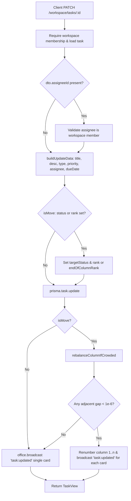

# Tasks & Kanban Board Architecture

## Purpose

The tasks subsystem provides issue tracking directly integrated into the virtual office. It manages per-workspace Kanban boards, drag-and-drop card ordering via fractional ranking, real-time WebSocket synchronization across all connected workspace members, Jira-style sequential ticket keys (e.g. `DP-42`), and live task counts displayed on physical desks in the 2D office.

## Where it lives

### Backend (`apps/api`)
| File | Role |
| --- | --- |
| `apps/api/prisma/schema.prisma` | DB schema: `Task` model, enums (`TaskStatus`, `TaskPriority`, `TaskType`), indexes |
| `apps/api/src/tasks/tasks.controller.ts` | REST endpoints (`GET`, `POST`, `PATCH /:id`, `DELETE /:id`) under `/workspace/tasks` |
| `apps/api/src/tasks/tasks.service.ts` | Orchestration: advisory-locked creation, updates, rebalancing, broadcasts, member cleanup |
| `apps/api/src/tasks/tasks.dto.ts` | Request validation schemas for create/update using `class-validator` |
| `apps/api/src/tasks/tasks.rules.ts` | Pure domain logic: prefix derivation, midpoint ranks, gap checks, delete permissions |
| `apps/api/src/tasks/tasks.module.ts` | NestJS module registering controller, service, Prisma, and office gateway |
| `apps/api/src/tasks/tasks.rules.spec.ts` | Unit tests for prefix derivation, rank midpoint math, rebalance threshold, permissions |
| `apps/api/src/tasks/tasks.service.spec.ts` | Unit tests for service flows: assignee validation, deletion rights, member removal |

### Frontend (`apps/web`)
| File | Role |
| --- | --- |
| `apps/web/features/tasks/types.ts` | Domain types (`TaskView`, `TaskStatus`, `TaskPriority`, `TaskType`), filter shapes, labels |
| `apps/web/features/tasks/taskStore.ts` | Reactive store (`useSyncExternalStore`), socket listeners (`task:*`), optimistic mutations |
| `apps/web/features/tasks/useBoardDrag.ts` | Drag-and-drop gesture management, column midpoint caching, instant rank calculation |
| `apps/web/features/tasks/useBoardMembers.ts` | React hook fetching active workspace members via api client for assignee pickers and filter faces |
| `apps/web/features/tasks/boardFilterUtils.ts` | Pure matching logic checking tasks against query strings and assignee selections |
| `apps/web/features/tasks/taskDialogUtils.ts` | Form draft lifecycle, dirty check comparisons, and partial patch payload builders |
| `apps/web/features/tasks/TaskBoard.tsx` | Kanban container coordinating columns, board filters, search, and modal states |
| `apps/web/features/tasks/BoardDrawer.tsx` | Slide-out panel hosting the board over the 2D canvas with touch/drag drawer physics |
| `apps/web/features/tasks/BoardDrawerHandle.tsx` | Edge grab handle toggling the board drawer |
| `apps/web/features/tasks/BoardHeader.tsx` | Header bar showing counts, search input, filter faces cluster, and new task trigger |
| `apps/web/features/tasks/BoardFilters.tsx` | Quick filter bar with search input, quick filter toggles, and clear button |
| `apps/web/features/tasks/BoardFilterFaces.tsx` | Assignee avatar selector in the filter bar |
| `apps/web/features/tasks/TaskColumn.tsx` | Column view displaying column header, counter, card stack, and drop placeholders |
| `apps/web/features/tasks/TaskCard.tsx` | Draggable card rendering key, type icon, title, priority, assignee, and due date |
| `apps/web/features/tasks/TaskDialog.tsx` | Accessible modal portal container with escape key trapping and focus handling |
| `apps/web/features/tasks/CreateTaskDialog.tsx` | Modal form dialog for authoring new tasks |
| `apps/web/features/tasks/EditTaskDialog.tsx` | Modal form dialog for editing details, changing status, or deleting a task |
| `apps/web/features/tasks/EditTaskFooter.tsx` | Action buttons for edit modal (Save, Cancel, Delete with confirm popover) |
| `apps/web/features/tasks/TaskMetaFields.tsx` | Grid layout organizing type, status, priority, assignee, and due date inputs |
| `apps/web/features/tasks/TaskTitleField.tsx` | Controlled text input for task summary |
| `apps/web/features/tasks/TaskDescriptionField.tsx` | Controlled textarea for markdown task description |
| `apps/web/features/tasks/TaskTypeSelect.tsx` | Dropdown selector for `TASK`, `BUG`, `STORY` |
| `apps/web/features/tasks/TaskStatusSelect.tsx` | Dropdown selector for `TODO`, `IN_PROGRESS`, `IN_REVIEW`, `DONE` |
| `apps/web/features/tasks/TaskPrioritySelect.tsx` | Dropdown selector for `HIGHEST`, `HIGH`, `MEDIUM`, `LOW`, `LOWEST` |
| `apps/web/features/tasks/TaskAssigneeSelect.tsx` | Dropdown picker for selecting or unassigning a workspace member |
| `apps/web/features/tasks/TaskDueDateField.tsx` | Date input with picker for task deadline |
| `apps/web/features/tasks/PeoplePicker.tsx` | Searchable member selection popover |
| `apps/web/features/tasks/PeoplePickerList.tsx` | Scrollable member item list inside people picker |
| `apps/web/features/tasks/PeoplePickerOption.tsx` | Member row inside people picker list |
| `apps/web/features/tasks/TaskIcons.tsx` | SVG icons for issue types and priority arrows |

## How it works

### Data Model & Per-Workspace Keys
The `Task` model in Prisma tracks `id` (cuid), `workspaceId`, `number` (sequential integer), `type` (`TASK|BUG|STORY`), `title`, `description`, `status` (`TODO|IN_PROGRESS|IN_REVIEW|DONE`), `priority` (`HIGHEST|HIGH|MEDIUM|LOW|LOWEST`), nullable `assigneeId`, `reporterId`, nullable `dueDate`, `rank` (Float), and timestamps.
- **Key Prefix**: `workspacePrefix(name)` derives a 2-4 character uppercase prefix from the workspace name (e.g. "Dev Pulse" -> `DP`, "Acme Rocket Co" -> `ARC`, fallback `WS`).
- **Issue Key**: `taskKey(prefix, number)` formats the key as `${prefix}-${number}` (e.g. `DP-42`).
- **Advisory Lock**: In `TasksService.create()`, sequential numbering must not collide or produce duplicates. Inside a Prisma transaction, the service executes:
  `SELECT pg_advisory_xact_lock(hashtext(${workspaceId}))`
  This serializes concurrent creation transactions strictly per workspace without table-wide locking, ensuring safe atomic computation of `(MAX(number) ?? 0) + 1` against the `@@unique([workspaceId, number])` constraint.

### Permissions
Permission checks mirror standard Jira defaults:
- **Create**: Any active workspace member can create tasks. Assignees must belong to the workspace (`workspaceMember.count`).
- **Edit / Move**: Any active workspace member can update fields or move cards across columns.
- **Delete**: Restricted by `canDeleteTask()`. Only the ticket's `reporterId`, or a user with `OWNER` or `ADMIN` role, can delete. Other members receive `FormError('NOT_ALLOWED')`.

### Rank Algorithm & Rebalancing
Cards within each status column are ordered by `rank ASC, createdAt ASC`.
- **Midpoint Ranking**: The client (`useBoardDrag.ts`) picks a rank between its neighbours with the same midpoint idea:
  - Dropped into empty column: `1.0`.
  - Dropped at top above card $B$: `B.rank - 1.0`.
  - Dropped at bottom below card $A$: `A.rank + 1.0`.
  - Dropped between cards $A$ and $B$: `(A.rank + B.rank) / 2.0`.
- **Worked Example**:
  1. Column has Card A (`rank = 1.0`) and Card B (`rank = 2.0`).
  2. Drop Card C between A and B: `rank = (1.0 + 2.0) / 2 = 1.5`.
  3. Drop Card D between A and C: `rank = (1.0 + 1.5) / 2 = 1.25`.
  The client (`useBoardDrag.ts`) computes this rank immediately upon drop for zero-latency optimistic movement and sends `PATCH /workspace/tasks/:id` with `{ status, rank: 1.25 }`.
- **Status Change Without Rank**: If a card changes status without an explicit rank (e.g. via edit dialog status dropdown), `endOfColumnRank()` calculates `MAX(rank) + 1` (or `1.0`), placing it at the bottom.
- **Server Storage & Rebalancing**: The server stores the rank as sent and renumbers a column when the gap falls below `RANK_GAP_MIN` (`1e-6`) using `rebalanceColumnIfCrowded()`. Repeated midpoints in the same slot halve the gap; when `Math.abs(rankA - rankB) < RANK_GAP_MIN`, `rebalanceColumnIfCrowded()` queries the column ordered by `rank asc, createdAt asc`, renumbers cards sequentially `1..n` (`rank = i + 1`), and broadcasts `task:updated` for every card in that column.

### Update Flow

### Live Events & Web Store
- **Transport**: Broadcasts travel over the `/office` Socket.IO namespace to room `ws:${workspaceId}` via `OfficeGateway.broadcast(workspaceId, event, payload)`.
- **Events & Payloads**:
  - `task:created`: Full `TaskView`.
  - `task:updated`: Full `TaskView`.
  - `task:deleted`: `{ id: string }`.
- **Client Synchronization (`taskStore.ts`)**:
  - Subscribes via `useTaskSync(socket)`. On socket `connect` (or reconnect), calls `GET /workspace/tasks` to reconcile offline drift.
  - `upsert()` updates or appends the card, maintaining list order sorted by `rank asc`, then `number asc`.
  - `remove()` removes the task by ID.
  - State changes trigger `useSyncExternalStore` listeners, instantly re-rendering `TaskBoard` and desk paper stack counters (`countOpenTasks`).

### Member-Removed Handling
`TasksService` subscribes to `WorkspaceEvents.events$` on initialization. When a `member-removed` event occurs:
1. `handleMemberRemoved()` finds all tasks where `assigneeId === userId`.
2. Sets `assigneeId: null` via `prisma.task.updateMany`.
3. Broadcasts `task:updated` for each affected task to the workspace.
Tasks remain intact and unassigned rather than deleted.

## Rules & invariants

- **Workspace Scoping**: All operations verify workspace tenancy. Cross-workspace assignment or movement is impossible.
- **Immutable Keys**: `(workspaceId, number)` is unique and permanently assigned. Numbers never reuse or decrement.
- **Concurrency Serialization**: Creation is serialized with `pg_advisory_xact_lock(hashtext(workspaceId))` to prevent key collisions.
- **Valid Membership**: Assignees must belong to the workspace when assigned; departures trigger automatic unassignment.
- **Column Order**: Within any column, items are sorted by `rank ASC, createdAt ASC`. The minimum rank difference before rebalance is `1e-6`.
- **Role Permissions**: Creation/editing open to all workspace members; deletion restricted to reporter, OWNER, or ADMIN.

## Why it's built this way

- **Fractional Midpoint Ranking vs. Integer Ordering**: Midpoints allow inserting cards with a single row update (`O(1)`), avoiding rewriting ranks across the entire column (`O(N)` updates and severe DB lock contention during concurrent drags).
- **Client-Calculated Rank vs. Server-Only Placement**: The browser computes ranks using `useBoardDrag.ts` so the board renders optimistic position shifts with zero latency before backend confirmation; the server stores the rank and runs `rebalanceColumnIfCrowded()` when the gap falls below `RANK_GAP_MIN`.
- **Advisory Lock vs. Table Locks or Global Sequences**: `pg_advisory_xact_lock` using workspace hash serializes creation per workspace only. Other workspaces are completely unaffected, unlike global table locks (`LOCK TABLE`).
- **1e-6 Rebalance Threshold vs. Eager Normalization**: `1e-6` is well above IEEE 754 precision limits (~1e-16 relative), avoiding collision while keeping expensive column-wide renumbers and multi-card socket broadcasts exceedingly rare.
- **Office Gateway Integration vs. Separate WebSocket Connection**: Tasks share the existing `/office` socket room, preventing duplicate connections and keeping desk paper counters synchronized with the board.
- **Unassignment vs. Cascade Deletion**: Departing members unassign rather than delete tickets to preserve historical team work.

## How to change it safely

To maintain consistency, pure rules must stay decoupled from NestJS/Prisma in `tasks.rules.ts`, and frontend drag math in `useBoardDrag.ts` must mirror API rules.

### Adding a Field (Example: `estimate: Float?`)
1. **Schema & Migration**: Add `estimate Float?` to `model Task` in `apps/api/prisma/schema.prisma`. Run `pnpm dlx prisma migrate dev --name add_task_estimate`.
2. **DTOs**: In `apps/api/src/tasks/tasks.dto.ts`, add `@IsOptional() @IsNumber() estimate?: number | null;` to both `CreateTaskDto` and `UpdateTaskDto`.
3. **API Service**: In `apps/api/src/tasks/tasks.service.ts`:
   - Add `estimate: number | null;` to `TaskView`.
   - Map `estimate: task.estimate ?? null` in `toTaskView()`.
   - Pass `estimate: dto.estimate ?? null` in `create()` data block.
   - Add `if (dto.estimate !== undefined) data.estimate = dto.estimate;` in `buildUpdateData()`.
4. **Web Types**: In `apps/web/features/tasks/types.ts`, add `estimate?: number | null;` to `TaskView`, `NewTask`, and `TaskPatch`.
5. **Web Draft Utils**: In `apps/web/features/tasks/taskDialogUtils.ts`, add `estimate` to `Draft` interface, initialize it in draft factories, compare it in `checkHasUnsavedEdits`, and map it in `buildTaskPatch`.
6. **Web Form Field**: Create or update a numeric field component (e.g. inside `apps/web/features/tasks/TaskMetaFields.tsx`) bound to `draft.estimate`.
7. **Web Board Card**: In `apps/web/features/tasks/TaskCard.tsx`, render the estimate badge next to priority/type indicators.
8. **Tests**: Update `apps/api/src/tasks/tasks.service.spec.ts` mocks to verify `estimate` is persisted on create and update.

## Tests

- **Test Files**:
  - Pure rules: `apps/api/src/tasks/tasks.rules.spec.ts` (10 unit tests)
  - Service orchestration: `apps/api/src/tasks/tasks.service.spec.ts` (5 unit tests)
- **Command**: Run inside container via `docker compose exec api pnpm test src/tasks` (or `vitest run src/tasks` inside `apps/api`).
- **Coverage**:
  - `workspacePrefix`: multi-word acronyms, single-word prefixes, short words, symbol fallbacks.
  - `taskKey`: combination of prefix and sequential number.
  - `canDeleteTask`: permission matrix for OWNER, ADMIN, reporter, and regular member.
  - `needsRebalance`: gap threshold checks around `RANK_GAP_MIN` (`1e-6`).
  - `create`: assignee membership validation in workspace.
  - `remove`: deletion permission enforcement.
  - `member-removed`: unassigning affected tasks and broadcasting updates to the office.
