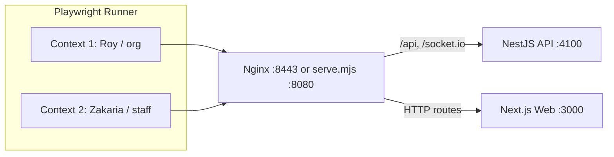

# Testing Architecture & Verification

## Purpose

DevPulse employs a multi-tiered verification strategy designed for speed, determinism, and real-world multi-user fidelity. Pure domain logic and mathematical rules are validated instantaneously in isolation via Vitest unit tests in `apps/api`. TypeScript compiler checks enforce static type safety across both frontend and backend. Full end-to-end user workflows—including WebRTC spatial audio, WebSocket office state broadcasts, interactive Kanban boards, and minigames—are validated across coordinated parallel browser instances via Playwright in `e2e`.

## Where it lives

| File | One-line job |
| --- | --- |
| `e2e/playwright.config.ts` | Playwright configuration (workers, retries, CPU renderer args, fake media devices, trace). |
| `e2e/global-setup.ts` | Pre-warms 19 frontend and API routes via HTTP fetch to prime Next.js compilation caches. |
| `e2e/serve.mjs` | CI same-origin proxy on `:8080` routing `/api` and `/socket.io` to NestJS and routes to Next.js. |
| `e2e/tests/support/browser.ts` | Page factory configuring 15 FPS/low-res caps, CSS blur stripping, WebRTC spies, and log traps. |
| `e2e/tests/support/users.ts` | User provisioning via accelerated dev sign-in API (`devUser`, `devOwner`) and form automation (`register`). |
| `e2e/tests/support/office.ts` | Office state queries (`workspace`), navigation (`gotoOffice`), and instant teleportation (`teleport`). |
| `e2e/tests/support/walker.ts` | Avatar motion: instant test `jumpTo` vs A* pathfinding arrow-key driver (`walkTo`). |
| `e2e/tests/support/fixtures.ts` | Extended Playwright test exporting the isolated two-user `team` fixture and clean console assertion. |
| `apps/api/src/dev/dev.controller.ts` | Non-production REST endpoints (`/api/auth/dev/users`, login) bypassing password and 2FA flows. |
| `apps/api/src/dev/dev.gateway.ts` | Non-production WebSocket gateway listening for `dev:teleport` events on the `/office` namespace. |
| `apps/web/features/dev/devHooks.ts` | Frontend hooks exposing `window.__devpulse` (`teleport`, `position`) and applying FPS/resolution caps. |
| `apps/api/src/config/app-config.ts` | Environment validation defining `isDevLoginEnabled` (`DEV_LOGIN=true` and `NODE_ENV !== 'production'`). |

## How it works

### Multi-Client Architecture & Topology



### Verification Layers

1. **Pure Rules Unit Tests**: Colocated `*.rules.spec.ts` files in `apps/api` execute via Vitest. They isolate mathematical calculations (rank midpoint math in `tasks.rules.spec.ts`, distance formulas in `proximity.spec.ts`, deck shuffle in `uno.rules.spec.ts`) without databases, networks, or mocking frameworks.
2. **Type Safety**: Evaluated across workspaces via `tsc --noEmit`. `apps/web` has no standalone unit tests; frontend UI logic and component interactions are verified through Playwright specs against the live canvas.
3. **E2E Playwright Suite**: Launches real Chromium browser contexts simulating simultaneous teammates in an office.

### Dev/Test Hooks & Production Guarding

To test multiplayer interactions without slow manual form fills, DevPulse provides test hooks that are strictly barred from production:
- **API Guard**: `isDevLoginEnabled(env)` in `apps/api/src/config/app-config.ts` requires `env.DEV_LOGIN === 'true' && env.NODE_ENV !== 'production'`. `AppModule` conditionally mounts `...devImports(process.env)` only when true. In production, `DevModule` is never imported—neither `DevController` nor `DevGateway` exists. `AuthController.devStatus()` (`GET /auth/dev`) is always mounted so the login page returns `{ enabled: false }` with HTTP 200 rather than triggering a 404 console error.
- **Web Guard**: `useDevLogin` queries `GET /auth/dev`. `useDevHooks` mounts `window.__devpulse` (`teleport`, `position`) only when `enabled === true`. In production, `window.__devpulse` is undefined.

### Support Layer Contracts

- **`browser.ts`**: `openPage()` injects render caps (`window.__devpulseFps = 15`, `window.__devpulseLowRes = true`), injects a stylesheet removing `backdrop-filter` blur effects, wraps `RTCPeerConnection` to record instances in `window.__calls` (polled via `connectedCalls()`), and intercepts console errors/warnings, page errors, and HTTP >= 400 responses into a `problems` array.
- **`users.ts`**: `devUser(page, name, host?)` and `devOwner(page, name)` hit `POST /api/auth/dev/users` to mint authenticated sessions in milliseconds. `register()` drives real form fields on `/register` (bypassing the dev switcher if present) for specs explicitly verifying registration.
- **`walker.ts`**: `jumpTo(page, tx, ty)` teleports directly via dev socket and awaits minimap settling (used when navigation is not the test subject). `walkTo(page, layout, tx, ty)` computes an A* route avoiding furniture and walls, drives arrow keys with minimap feedback, and handles seat stand-up delays.

## Rules & invariants

1. **Test Independence & Suite Organization**:
   - `e2e/tests/office.spec.ts` builds a dedicated office per test via the `team` fixture and can run in any order or isolation.
   - Serial story suites (`board.spec.ts`, `chill.spec.ts`, `foosball.spec.ts`, `lego.spec.ts`, `office-live.spec.ts`, `uno.spec.ts`) configure `mode: 'serial'` and initialize a single shared office in `beforeAll` / setup tests to model continuous multi-step team workflows.
2. **Zero Console Pollution**: Every test run must keep the browser console and network clean. Specs assert clean logs per test via `expectCleanConsole` (`office.spec.ts` / `team` fixture) or across the suite via `expect(problems.flat()).toEqual([])` in the final test of serial stories.
3. **No Unexplained Sleeps**: `page.waitForTimeout()` is forbidden unless preceded by a descriptive comment detailing why waiting is required (e.g. canvas loop pause settling, CSS transition, speech bubble expiration).
4. **Screenshots on Demand**: Review captures use `shotPath()` (defaults to `e2e/test-results/shots`, overridden by `SHOTS_DIR`) and `E2E_SHOTS` (in `board.spec.ts`). Playwright automatic captures remain disabled (`screenshot: 'off'`).
5. **Sign-up is rate limited**: only two `office.spec.ts` tests use the real forms (`register()`); everything else signs in through the dev API, so a full run stays under the register throttle (see `REGISTER_THROTTLE_LIMIT` in `apps/api/src/auth/auth.controller.ts`).
6. **Don't click on a canvas piece right after a refused editor drop**: where the refused piece sits on screen varies with frame timing, so the editor test selects first and drags last (the old order failed about 1 run in 3).
7. **No Production Leaks**: All dev endpoints and socket listeners must be guarded behind `isDevLoginEnabled`.

## Why it's built this way

- **Canvas 2D fallback over Software WebGL**: Headless Chromium running software WebGL (`swiftshader`) is ~10x slower than 2D canvas rendering and starves parallel CPU workers. Playwright runs with `--disable-gpu --disable-3d-apis` by default, forcing Phaser to its lightweight canvas renderer (`E2E_WEBGL=1` enables SwiftShader for explicit WebGL verification).
- **Dev sign-in API over UI forms**: Standard account sign-up is rate-limited and runs password hashing. Tests use `POST /api/auth/dev/users` for sub-second user setup, reserving full UI registration flows for dedicated sign-up specs.
- **`jumpTo` vs. `walkTo`**: Real walking via arrow keys exercises A* pathfinding and collision physics, which can drop inputs under heavy CPU load. Specs use `jumpTo` for immediate placement unless movement mechanics or proximity boundaries are under test.
- **Stripping `backdrop-filter`**: Blurred CSS overlays positioned above active animated canvases cost ~1 second per frame in software rendering without GPU acceleration. Injected styles remove blur filters without altering DOM structure.
- **CI same-origin proxy (`serve.mjs`)**: Lightweight reverse proxy forwarding `/api` and `/socket.io` to `:4100` and pages to `:3000` on port `8080`, allowing CI to mirror production Nginx routing without running Docker.
- **15 FPS cap & low resolution**: Capping Phaser frame rates via `window.__devpulseFps` preserves CPU headroom across concurrent workers.

## How to change it safely

### Writing a new spec with the `team` fixture

Create a new test file under `e2e/tests/` consuming the `team` fixture from `./support/fixtures`. The fixture provisions an organiser (`Roy`) and teammate (`Zakaria`) in a fresh workspace, cleans contexts on exit, and verifies logs remain clean:

```ts
import { expect, test } from './support/fixtures';

test('a message to the office reaches everyone', async ({ team }) => {
  const { org, staff } = team;
  await org.getByRole('button', { name: 'Open chat' }).click();
  await org.getByLabel('Message the office').fill('Stand-up in 5 minutes');
  await org.getByLabel('Message the office').press('Enter');
  await staff.getByRole('button', { name: /Open chat/ }).click();
  await expect(staff.getByRole('log').getByText('Stand-up in 5 minutes')).toBeVisible();
});
```

### Maintenance checklist

- Decouple pure domain calculations from NestJS/Prisma into `*.rules.ts` and verify them with colocated Vitest specs.
- When adding E2E assertions, use `expect.poll` for asynchronous canvas state rather than static sleeps.
- Always run typechecking on both `apps/api` and `apps/web` before running E2E suites.

## Tests

The project `Makefile` manages the Docker Compose stack (`make up`, `make dev`, `make clean`) and defines no test targets. Tests run directly via `pnpm`:

### Unit & Typecheck Commands

```bash
# Pure rules unit tests (inside Docker container or local api package)
docker compose exec api pnpm test
pnpm --filter api test

# Run a specific rules specification
docker compose exec api pnpm test src/tasks/tasks.rules.spec.ts

# Static TypeScript checks
pnpm --filter api typecheck
pnpm --filter web typecheck
```

### End-to-End Commands

Run from repo root against the running Docker stack:

```bash
# Run a single E2E spec file against the local Docker stack
E2E_BASE_URL=https://localhost:8443 pnpm --dir e2e exec playwright test tests/office.spec.ts

# Filter tests by title regex
E2E_BASE_URL=https://localhost:8443 pnpm --dir e2e exec playwright test -g "nearby"

# Run the complete test suite across 3 workers
E2E_BASE_URL=https://localhost:8443 pnpm --dir e2e test:full
```

Under CI pipelines without Docker:
```bash
node e2e/serve.mjs &
pnpm --dir e2e test
```
